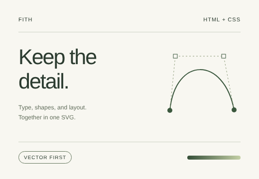
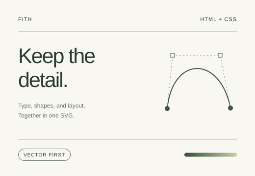

# fith — HTML to SVG

**Turn rendered HTML into a portable, vector-first SVG.**

[English](./README.md) · [简体中文](./README.zh-CN.md)

fith uses the browser's computed layout to capture an HTML page or element as SVG. Text, boxes, borders, gradients and supported effects become SVG graphics; regions SVG cannot express fall back to embedded pictures when the backend can provide them. Use it to export UI cards, dashboards, illustrations and page snapshots from HTML you already have.

> Vector-first is not entirely vector or pixel-perfect for every page. Fidelity depends on the page, fonts, backend and SVG viewer; see [supported content and limitations](./docs/en/limitations.md).

| HTML screenshot | SVG output |
| --- | --- |
|  |  |

**fith** is short for **fitting HTML**: `fit` means fitting, `h` stands for HTML.

## Install

Requires Node.js 18+ and pnpm. The first npm release is not out yet, so build from source:

```bash
git clone https://github.com/0x0079/fith.git
cd fith
pnpm install
pnpm exec playwright install chromium
pnpm build
```

Once released, `npm install fith playwright` (Playwright is an optional peer, needed only for the Node backend).

## Use

**Command line**

```bash
node dist/backends/node/cli.js homepage/public/examples/card.html -o card.svg --width 520 --height 360
# after installing the package: fith input.html -o out.svg
```

**Node**

```js
import { htmlToSvg } from 'fith/node'; // './dist/node.js' in a checkout

const svg = await htmlToSvg('<h1>Hello, SVG</h1>', { width: 800, height: 300 });
```

**Browser** (no Node, no Playwright)

```ts
import { captureElement } from 'fith/browser';

const svg = await captureElement(document.querySelector('.card')!);
```

**Chrome extension**: `pnpm build:extension`, then load `dist/extension/` from `chrome://extensions`.

## Entries

| Entry | Contents | Needs |
|---|---|---|
| `fith` | scene types, `emitSvg`, `buildReport` | nothing |
| `fith/node` | `htmlToSvg`, `renderToSvg`, `renderDetailed` | optional peer `playwright` (and `opentype.js` for `fontMode: 'outline'`) |
| `fith/browser` | `captureCurrentPage`, `captureElement`, `captureSourceHtml` | nothing |
| `fith/outline` | `createOutliner` for outline mode in the browser | optional peer `opentype.js` |

## Documentation

- [Node API and CLI](./docs/en/node-cli.md): options, pages and URLs, source snapshots for bug reports
- [Browser library](./docs/en/browser.md): `rasterize`, `fonts`, `idPrefix`, and the report of what was not drawn as vectors
- [Chrome extension](./docs/en/extension.md)
- [Fonts](./docs/en/fonts.md): `embed`, `outline`, `none`
- [Supported content and limitations](./docs/en/limitations.md)
- [Development](./docs/en/development.md): how it works, validation, tests, contributing
- Design notes (Chinese): [DESIGN.md](./DESIGN.md), [.design/](./.design/)

## Contributing

[Issues](https://github.com/0x0079/fith/issues) and pull requests are welcome. For a rendering bug, include a minimal HTML reproduction, the backend, viewport size and font mode. Run `pnpm build`, `pnpm build:extension` and `pnpm test` before submitting.

## License

[Mozilla Public License 2.0](./LICENSE). Font, image and captured page content keep their own licenses.
